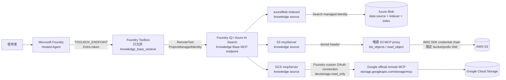

# Lab 5：Foundry IQ 跨雲 Grounding

**前置條件**：[Lab 3](03-lab3-deploy.md) 的 Hosted Agent 工具鏈可用；Azure、
AWS、Google Cloud 都有一個可供測試的 object storage 位置。
**完成條件**：Hosted Agent 只看得到 `knowledge_base_retrieve`，並可用 citations
回答 Azure Blob、AWS S3、Google Cloud Storage 各一題及一題跨來源問題。

> **版本基準：2026-08-23。** 本 Lab 使用 Azure AI Search
> `2026-05-01-preview`。MCP Server knowledge source、可調整的 reasoning effort
> 與跨第三方服務整合仍屬 preview，沒有 SLA，不建議原樣用於 production。

---

## 目標

建立一個不把三朵雲 credentials 放進 Hosted Agent 的 grounding 層：



Agent container 只有三個設定：

- `FOUNDRY_PROJECT_ENDPOINT`
- `AZURE_AI_MODEL_DEPLOYMENT_NAME`
- `TOOLBOX_ENDPOINT`

它不持有 Storage connection string、AWS access key、Google refresh token 或 S3
proxy bearer token。Azure AI Search/Foundry IQ 負責 source selection、query planning、
tool invocation、reranking 與 answer synthesis。

---

## 為什麼採這個設計

| 來源 | 本 Lab 的路徑 | 原因 |
| --- | --- | --- |
| Azure Blob | 原生 `azureBlob` indexed knowledge source | Azure AI Search 自動建立並管理 Blob data source、skillset、indexer 與 search index；可用 managed identity，不放 Storage key |
| Google Cloud Storage | Google 官方 remote MCP + Foundry custom OAuth connection | 使用 Google 支援的工具與 read-only OAuth scope；Foundry Agent Service 呼叫 KB 時才解析 OAuth connection |
| AWS S3 | 自建窄介面、唯讀 MCP proxy | 不把官方 AWS MCP 的通用 `aws___run_script` 暴露給 KB；proxy 與 IAM 都鎖定單一 bucket/prefix |

官方 managed AWS MCP 的 `aws___run_script` 可執行 Python 並存取很大的 AWS API
表面；即使執行環境是 sandbox，也不能取代 least-privilege IAM。Foundry RemoteTool
也沒有原生 SigV4 auth type；SigV4 的 request signing、短效 session token 與 AWS
OAuth/DCR redirect lifecycle 都需要額外轉接。教學場景改用兩個明確的唯讀工具，比把
通用 AWS 執行器接進 retrieval pipeline 更容易審查。

---

## 步驟一：準備工具與資源

### CLI

```bash
az --version
azd version
aws --version
gcloud version
uv --version
```

需要 Docker 才能在本機建 S3 proxy image；沒有 Docker 時仍可執行 Python 版與單元測試。

### Azure

- 一個支援 agentic retrieval 的 Azure AI Search service，已啟用 system-assigned
  managed identity，API access control 設為 **RBAC** 或 **Both**
- 一個 Storage Account 與 Blob container
- 一個 Microsoft Foundry project
- 一個支援 tool calling 的 chat model deployment
- 一個 embedding deployment，例如 `text-embedding-3-large`

角色與範圍：

| 身分 | 角色 | 範圍 | 用途 |
| --- | --- | --- | --- |
| 建置者 | `Search Service Contributor` | Search service | 建 knowledge source、KB 與 generated indexer pipeline |
| 上傳 sample 的使用者 | `Storage Blob Data Contributor` | Storage Account 或 container | 上傳 Lab 文件 |
| Search service managed identity | `Storage Blob Data Reader` | Storage Account 或 container | indexer 讀 Blob |
| Search service managed identity | `Cognitive Services User` | Foundry account | embedding、query planning、answer synthesis |
| Foundry project managed identity | `Search Index Data Reader` | Search service | `ProjectManagedIdentity` connection 呼叫 KB |
| 建置者 | `Foundry Project Manager` | Foundry project | 建 project connection、toolbox、agent |

用 Portal 指派最不容易選錯 principal。CLI 版先取得 resource ID 與 principal：

```bash
export SEARCH_ID=$(az search service show \
  --name "$AZURE_SEARCH_SERVICE_NAME" \
  --resource-group "$AZURE_RESOURCE_GROUP" \
  --query id -o tsv)
export SEARCH_MI=$(az search service show \
  --name "$AZURE_SEARCH_SERVICE_NAME" \
  --resource-group "$AZURE_RESOURCE_GROUP" \
  --query identity.principalId -o tsv)
export PROJECT_MI=$(az rest --method get \
  --url "https://management.azure.com${FOUNDRY_PROJECT_RESOURCE_ID}?api-version=2025-04-01-preview" \
  --query identity.principalId -o tsv)
```

再依上表指派；下列 scope 都是參數，不可貼別人的 ID：

```bash
az role assignment create \
  --assignee-object-id "$SEARCH_MI" --assignee-principal-type ServicePrincipal \
  --role "Storage Blob Data Reader" --scope "$AZURE_STORAGE_RESOURCE_ID"

az role assignment create \
  --assignee-object-id "$SEARCH_MI" --assignee-principal-type ServicePrincipal \
  --role "Cognitive Services User" --scope "$FOUNDRY_ACCOUNT_RESOURCE_ID"

az role assignment create \
  --assignee-object-id "$PROJECT_MI" --assignee-principal-type ServicePrincipal \
  --role "Search Index Data Reader" --scope "$SEARCH_ID"
```

### AWS

- 一個 S3 bucket 與非空 prefix，例如 `lab5/aws/`
- 本機測試使用 IAM Identity Center/SSO profile
- 託管 proxy 使用 workload role；不得把 access key 烤進 image
- proxy 對外需有 Azure AI Search 可達的 HTTPS `/mcp` endpoint

### Google Cloud

- 一個 project 與 GCS bucket
- 已啟用 Cloud Storage API
- OAuth consent screen 與一個 **Web application** OAuth client
- 呼叫者在 consumer project 有 `roles/mcp.toolUser`
- 呼叫者在目標 bucket 有 `roles/storage.objectViewer`

這兩個 predefined roles 足以使用 `list_objects`、`read_object`、
`get_object_metadata`。它們不包含 `list_buckets`，本 Lab 也不允許該工具。

---

## 步驟二：上傳三份可辨識 sample

檔案已放在 [`lab5/sample-data/`](../lab5/sample-data/)：

| 來源 | 檔案 | 唯一驗證值 |
| --- | --- | --- |
| Azure Blob | `azure/azure-governance.md` | `AURORA-BLOB-527` |
| AWS S3 | `aws/aws-operations.md` | `CEDAR-S3-814` |
| GCS | `gcp/gcp-retention.md` | `ORBIT-GCS-936` |

### Azure Blob

```bash
az storage blob upload \
  --auth-mode login \
  --account-name "$AZURE_STORAGE_ACCOUNT_NAME" \
  --container-name "$AZURE_BLOB_CONTAINER" \
  --name "lab5/azure/azure-governance.md" \
  --file "lab5/sample-data/azure/azure-governance.md" \
  --overwrite
```

### AWS S3

```bash
aws sso login --profile "$AWS_PROFILE"
aws s3 cp \
  "lab5/sample-data/aws/aws-operations.md" \
  "s3://${S3_BUCKET}/${S3_PREFIX}aws-operations.md" \
  --profile "$AWS_PROFILE"
```

### Google Cloud Storage

```bash
gcloud storage cp \
  "lab5/sample-data/gcp/gcp-retention.md" \
  "gs://${GCS_BUCKET}/lab5/gcp/gcp-retention.md"
```

三個檔案刻意互不重複。後面的問題若答錯來源，很容易看出來。

---

## 步驟三：部署窄介面的 S3 MCP proxy

程式位於 [`lab5/s3-mcp-proxy/`](../lab5/s3-mcp-proxy/)。它的安全邊界有兩層：

1. API 只存在 `list_objects` 與 `read_object`，沒有 bucket、region、credential、
   ARN、URL 或任意 AWS API 參數。
2. server 設定與 IAM policy 都鎖定相同 bucket/prefix。

`read_object` 只讀 UTF-8 文字、限制 object size，不回 presigned URL。

### 3.1 IAM policy

複製 [`iam-policy.json`](../lab5/s3-mcp-proxy/iam-policy.json)，把
`<approved-bucket>`、`<approved-prefix-without-trailing-slash>` 換成實際值，再綁到
proxy workload role。IAM 範本的 prefix 不含結尾 `/`；proxy 的 `S3_PREFIX` 則使用
`lab5/aws/` 這類帶結尾 `/` 的值。
核心權限只有：

```json
{
  "Action": "s3:ListBucket",
  "Resource": "arn:aws:s3:::<approved-bucket>",
  "Condition": {
    "StringLike": {
      "s3:prefix": ["<approved-prefix-without-trailing-slash>/*"]
    }
  }
}
```

以及：

```json
{
  "Action": "s3:GetObject",
  "Resource": "arn:aws:s3:::<approved-bucket>/<approved-prefix-without-trailing-slash>/*"
}
```

若物件使用 customer-managed SSE-KMS key，另加只對該 key 的 `kms:Decrypt`，並在
KMS key policy 授權同一 workload role；不要給 `kms:*`。

### 3.2 本機執行

```bash
cd lab5/s3-mcp-proxy
cp .env.example .env
# 填 S3_BUCKET、S3_PREFIX、AWS_REGION、S3_MCP_API_KEY
aws sso login --profile "$AWS_PROFILE"
uv sync --dev
uv run python -m s3_mcp_proxy.server
```

另一個終端機：

```bash
curl -fsS http://127.0.0.1:8000/healthz

# 未帶 bearer token 必須回 401
curl -i http://127.0.0.1:8000/mcp
```

`localhost` 只能做開發測試；Azure AI Search 無法連到你的電腦。

### 3.3 建 image

```bash
docker build -t s3-read-only-mcp:lab5 lab5/s3-mcp-proxy
```

### 3.4 部署位置

**建議**：ECS/Fargate、App Runner 或其他 AWS compute，直接掛上前述 workload role。
這樣 AWS SDK default credential provider chain 取得短效 credentials，不需任何長效 key。

**PoC 備援**：Azure Container Apps。範本
[`infra/aca.bicep`](../lab5/s3-mcp-proxy/infra/aca.bicep) 支援：

- external HTTPS ingress
- `/healthz` liveness/readiness probe
- 既有 Key Vault secret URI
- user-assigned managed identity 讀 Key Vault
- 所有 resource name、image、bucket、prefix、region 都由參數帶入

先讓該 identity 在 Key Vault 具備 `Key Vault Secrets User`。部署時只傳 secret URI，
不傳 secret value：

```bash
az deployment group create \
  --resource-group "$AZURE_RESOURCE_GROUP" \
  --template-file lab5/s3-mcp-proxy/infra/aca.bicep \
  --parameters \
    containerAppName="$S3_PROXY_APP_NAME" \
    containerAppsEnvironmentId="$ACA_ENVIRONMENT_ID" \
    image="$S3_PROXY_IMAGE" \
    keyVaultIdentityResourceId="$KEY_VAULT_IDENTITY_ID" \
    s3McpApiKeySecretUri="$S3_MCP_API_KEY_SECRET_URI" \
    awsAccessKeyIdSecretUri="$AWS_ACCESS_KEY_ID_SECRET_URI" \
    awsSecretAccessKeySecretUri="$AWS_SECRET_ACCESS_KEY_SECRET_URI" \
    s3Bucket="$S3_BUCKET" s3Prefix="$S3_PREFIX" awsRegion="$AWS_REGION"
```

`image` 必須可由該 Container Apps environment 拉取；範本不會建立 registry 或擴大
registry 權限。

ACA 範本中的 AWS access key 是教學 PoC fallback，不是 production 建議。正式環境應先
驗證 `AssumeRoleWithWebIdentity` 或 IAM Roles Anywhere；OIDC trust 必須綁定精確
issuer、`aud`、`sub`，不可 wildcard。無法正確 federate 時，寧可把 proxy 放在 AWS，
不要把 AWS credentials 送進 Hosted Agent 或 Foundry connection。

記下輸出的 HTTPS `/mcp` URL，填入 `S3_MCP_SERVER_URL`。

---

## 步驟四：建立 GCS custom OAuth project connection

Google Cloud Storage 官方 remote MCP endpoint 是：

```text
https://storage.googleapis.com/storage/mcp
```

Google MCP **不支援 Dynamic Client Registration (DCR)**，也不支援 OAuth Client ID
Metadata Document。必須自己建立 Web OAuth client，並把 Foundry 對此 connection 產生的
callback URI 逐字加入 Google。

### 4.1 啟用 API 與最小權限

```bash
gcloud services enable storage.googleapis.com --project "$GCP_PROJECT_ID"

gcloud projects add-iam-policy-binding "$GCP_PROJECT_ID" \
  --member="user:${GCP_USER_EMAIL}" \
  --role="roles/mcp.toolUser"

gcloud storage buckets add-iam-policy-binding "gs://${GCS_BUCKET}" \
  --member="user:${GCP_USER_EMAIL}" \
  --role="roles/storage.objectViewer"
```

正式環境可改用專用 workload/agent identity；不要沿用具管理員權限的人類帳號。

### 4.2 建 Web OAuth client

Google Cloud Console → **Google Auth Platform**：

1. 設定 Branding、Audience 與 Data Access。
2. 建立 **Web application** client。
3. callback 尚未產生時先放一個暫時 URI，例如 `https://localhost/placeholder`。
4. 記下 client ID 與 client secret；secret 不可提交。

### 4.3 在 Foundry 建 connection

Portal 路徑：Foundry project → **Build → Tools → Custom MCP**，選 custom OAuth：

| 欄位 | 值 |
| --- | --- |
| Target | `https://storage.googleapis.com/storage/mcp` |
| Authorization URL | `https://accounts.google.com/o/oauth2/v2/auth` |
| Token URL | `https://oauth2.googleapis.com/token` |
| Scope | `https://www.googleapis.com/auth/devstorage.read_only` |
| Client ID / secret | 上一步的 Web OAuth client |

CLI 等價做法如下。不要把 secret 寫進腳本或 shell history；能用 Portal 的 secret 欄位時
優先用 Portal：

```bash
azd ai connection create "$GCS_CONNECTION_NAME" \
  --kind remote-tool \
  --target "https://storage.googleapis.com/storage/mcp" \
  --auth-type oauth2 \
  --client-id "$GCS_OAUTH_CLIENT_ID" \
  --client-secret "$GCS_OAUTH_CLIENT_SECRET" \
  --authorization-url "https://accounts.google.com/o/oauth2/v2/auth" \
  --token-url "https://oauth2.googleapis.com/token" \
  --scopes "https://www.googleapis.com/auth/devstorage.read_only" \
  --project-endpoint "$FOUNDRY_PROJECT_ENDPOINT"
```

### 4.4 讀 callback，再回 Google 登記

```bash
export GCS_CALLBACK_URI=$(az rest --method get \
  --url "https://management.azure.com${FOUNDRY_PROJECT_RESOURCE_ID}/connections/${GCS_CONNECTION_NAME}?api-version=2025-10-01-preview" \
  --query properties.redirectUrl -o tsv)
echo "$GCS_CALLBACK_URI"
```

回 Google OAuth client：

1. **Authorized redirect URIs** 加入上面輸出的完整 URI。
2. 刪除暫時 URI。
3. 儲存。

取得完整 connection resource ID，填入 `lab5/.env`：

```bash
export GCS_FOUNDRY_CONNECTION_ID=$(az rest --method get \
  --url "https://management.azure.com${FOUNDRY_PROJECT_RESOURCE_ID}/connections/${GCS_CONNECTION_NAME}?api-version=2025-10-01-preview" \
  --query id -o tsv)
```

第一次由 Agent Service 呼叫時會回 consent URL；以具備上列 Google IAM roles 的使用者
完成一次 consent 後重試。

### `x-goog-user-project`

一般 bucket 不需額外設定。下列情況需要 quota/billing project：

- Google 無法從 client 判斷 quota project
- Requester Pays bucket，否則會回 `400 UserProjectMissing`

呼叫者還需在 quota project 具備 `serviceusage.services.use`（通常是
`roles/serviceusage.serviceUsageConsumer`），並送出：

```http
x-goog-user-project: <quota-project-id>
```

Foundry IQ 支援 query-time MCP source control headers，但 Hosted Agent/Toolbox 路徑未必
能替每一位使用者動態提供這個 header。本 Lab 預設使用非 Requester Pays bucket；若
企業需求一定需要該 header，請在經驗證的 custom connection header 功能設定固定 quota
project，或在 GCS 前加一個受控 proxy。不要把 billing project 猜成 bucket owner。

---

## 步驟五：建立三個 knowledge source 與 combined KB

### 5.1 填環境

```bash
cd lab5
cp .env.example .env
```

填完所有 `<...>`。任何 resource name 都可由環境變數覆寫；預設名稱：

| 資源 | 預設 |
| --- | --- |
| Blob knowledge source | `cross-cloud-blob-ks` |
| S3 knowledge source | `cross-cloud-s3-ks` |
| GCS knowledge source | `cross-cloud-gcs-ks` |
| Knowledge Base | `cross-cloud-grounding-kb` |
| Foundry RemoteTool connection | `cross-cloud-kb-mcp` |

### 5.2 先看 plan

```bash
uv sync --dev
uv run python -m foundry_iq.provision plan
```

這一步不呼叫 Azure。輸出應符合 [`configs/`](../lab5/configs/) 的 REST 範本；S3
bearer token 會顯示成 `<redacted>`。

確認：

- API version 是 `2026-05-01-preview`
- GCS 只有 `list_objects`、`read_object`、`get_object_metadata`
- S3 只有 `list_objects`、`read_object`
- 每個 MCP tool 都有 `inclusionMode: reranked`、合理的 `maxOutputTokens`
- GCS auth 是 `foundryConnection`
- S3 auth 是 write-only `storedHeaders`
- KB 是 `outputMode: answerSynthesis`、`retrievalReasoningEffort.kind: low`

### 5.3 建立

```bash
uv run python -m foundry_iq.provision apply
uv run python -m foundry_iq.provision check
```

Blob source 是 Foundry IQ 原生 indexed source。建立回應的
`azureBlobParameters.createdResources` 應列出：

- `datasource`
- `skillset`
- `indexer`
- `index`

到 Azure portal → Search service 確認 indexer 成功。這些 generated objects 有固定
template；不要直接改名稱或 schema，否則會破壞 managed pipeline。

### `foundryConnection` 的重要限制

GCS source 的 connection **只有 Foundry Agent Service 呼叫這個 KB 時才會解析**。
直接用 curl、Search Explorer 或其他 MCP client 呼叫 combined KB 時，GCS OAuth 不會被
注入。這不是設定錯誤；完整 GCS 與跨來源驗收必須走部署後的 Hosted Agent。

---

## 步驟六：建立 Toolbox

Knowledge Base MCP endpoint 格式固定為：

```text
https://<search>.search.windows.net/knowledgebases/<kb>/mcp?api-version=2026-05-01-preview
```

`provision apply` 已建立對此 endpoint 的 Foundry `RemoteTool` connection：

```json
{
  "authType": "ProjectManagedIdentity",
  "category": "RemoteTool",
  "audience": "https://search.azure.com/"
}
```

Toolbox CLI 需要 active azd environment。先在 `lab5/` 建立環境並綁定既有 project：

```bash
cd lab5
azd env new cross-cloud-grounding
azd env set AZURE_SUBSCRIPTION_ID "$AZURE_SUBSCRIPTION_ID"
azd env set AZURE_RESOURCE_GROUP "$AZURE_RESOURCE_GROUP"
azd env set FOUNDRY_PROJECT_ENDPOINT "$FOUNDRY_PROJECT_ENDPOINT"
azd env set AZURE_AI_PROJECT_ENDPOINT "$FOUNDRY_PROJECT_ENDPOINT"
azd env set AZURE_AI_PROJECT_ID "$FOUNDRY_PROJECT_RESOURCE_ID"
```

產生 resolved toolbox YAML：

```bash
uv run python -m foundry_iq.provision toolbox > toolbox.resolved.yaml
azd ai toolbox create cross-cloud-grounding \
  --from-file toolbox.resolved.yaml \
  --project-endpoint "$FOUNDRY_PROJECT_ENDPOINT"
```

Toolbox 只掛一個 KB MCP source，並明確設定：

```yaml
allowed_tools:
  - knowledge_base_retrieve
```

Knowledge Base endpoint 本身也只暴露 `knowledge_base_retrieve`。因此 generic AWS
tool、GCS write tool 與 object-store credentials 都不會出現在 Agent 的 `tools/list`。

設定 consumer endpoint；使用 unversioned URL 才會跟著 toolbox default version：

```bash
export TOOLBOX_ENDPOINT="${FOUNDRY_PROJECT_ENDPOINT%/}/toolboxes/cross-cloud-grounding/mcp?api-version=v1"
azd env set TOOLBOX_ENDPOINT "$TOOLBOX_ENDPOINT"
```

---

## 步驟七：部署 Hosted Agent

程式位於 [`lab5/hosted-agent/main.py`](../lab5/hosted-agent/main.py)，使用官方
`FoundryToolbox` wrapper；沒有自己手寫 MCP token refresh 或 cloud SDK。

沿用步驟六的 azd environment，將 model 與 Toolbox 值帶入：

```bash
cd lab5
azd env set AZURE_AI_MODEL_DEPLOYMENT_NAME "$AZURE_AI_MODEL_DEPLOYMENT_NAME"
azd env set TOOLBOX_ENDPOINT "$TOOLBOX_ENDPOINT"
azd deploy --no-prompt
```

`azure.yaml` 使用 direct code deployment，不需要為 Agent 再建一個 ACR。

確認：

```bash
azd ai agent show --output json
azd ai toolbox show cross-cloud-grounding --output json
azd ai agent invoke "列出你可用的工具名稱，不要呼叫工具。"
```

成功判準：只看到 Knowledge Base 的 `knowledge_base_retrieve`，不會看到
`aws___run_script`、`write_text`、`delete_object` 或任何 cloud credential。

---

## 步驟八：驗證 retrieval、activity 與 citations

### 8.1 先看 Foundry IQ REST envelope

用只會命中 Azure Blob 或 S3 的問題做 direct retrieve，可直接檢查
`references` 與 `activity`：

```bash
export SEARCH_TOKEN=$(az account get-access-token \
  --scope https://search.azure.com/.default \
  --query accessToken -o tsv)

curl -sS -X POST \
  "${AZURE_SEARCH_ENDPOINT}/knowledgebases/${KNOWLEDGE_BASE_NAME:-cross-cloud-grounding-kb}/retrieve?api-version=2026-05-01-preview" \
  -H "Authorization: Bearer ${SEARCH_TOKEN}" \
  -H "Content-Type: application/json" \
  -d '{
    "messages": [{
      "role": "user",
      "content": [{
        "type": "text",
        "text": "Azure Aurora 的驗證代碼與 RTO 是什麼？"
      }]
    }],
    "includeActivity": true,
    "outputMode": "answerSynthesis",
    "retrievalReasoningEffort": {"kind": "low"},
    "maxRuntimeInSeconds": 60
  }' | tee retrieve.json

jq '.references, .activity' retrieve.json
```

檢查：

- `references[]` 有 source 名稱、title/content 與 reranker score
- `activity[]` 顯示選了哪個 source
- MCP source 被呼叫時，每一次 tool invocation 都有獨立 activity record

Knowledge Base 的 **MCP** 回應與 retrieve REST envelope 不同：目前 MCP tool result
通常在 `result.content[].text`，不會另外回傳 top-level `references`、`activity`。
因此要看 Foundry IQ 的完整 retrieval diagnostics，用上面的 retrieve action 或 Portal；
要看實際 Agent tool call，用下一節的 Hosted Agent traces。

### 8.2 四個 Hosted Agent 問題

```bash
# Azure 單一來源
azd ai agent invoke \
  "Azure Aurora 的驗證代碼、備份窗口與 RTO 是什麼？請附 citation。"

# AWS 單一來源
azd ai agent invoke \
  "請從 S3 的 lab5/aws/ 找出 Cedar 維運摘要，告訴我驗證代碼與負責團隊，附 citation。"

# GCP 單一來源
azd ai agent invoke \
  "請從 GCS 的 lab5/gcp/ 找出 Orbit 保存摘要，告訴我驗證代碼與保留天數，附 citation。"

# 跨來源
azd ai agent invoke \
  "請跨 Azure Blob、AWS S3、GCS 列出三份摘要的驗證代碼、負責團隊與時間/保存資訊，逐列附 citation。"
```

預期：

| 問題 | 必須出現 |
| --- | --- |
| Azure | `AURORA-BLOB-527`、45 分鐘、Azure Operations |
| AWS | `CEDAR-S3-814`、AWS Operations |
| GCP | `ORBIT-GCS-936`、120 天、GCP Operations |
| 跨來源 | 三個驗證代碼，且 citation 不可串錯來源 |

第一次 GCS 呼叫若回 `CONSENT_REQUIRED`，開啟 nested error 中的 consent URL、完成 Google
OAuth，再重送同一題。

### 8.3 看 Hosted Agent tool invocation 與 citations

```bash
azd ai agent monitor --follow
```

或 Foundry portal → Agent → **Tracing**。確認：

1. Agent 呼叫 Toolbox。
2. tool 名稱為 `knowledge_base_retrieve`。
3. tool arguments 是使用者問題，不含 AWS/Google/Azure credentials。
4. Knowledge Base activity 顯示對應 source 與 MCP tool。
5. 最終回覆的 citation title/source 能對回 sample 文件。

若 Agent 回了正確文字卻沒有 citation，仍算驗收失敗；答案可能來自 model 記憶，而不是
可稽核的 grounding。

---

## Object-store MCP 的能力邊界

`list_objects` + `read_object` **不是真正的語意搜尋**。它適合：

- 已知 bucket、key 或 prefix
- 少量文件的 PoC
- 需要讀取即時 object，而不想先同步

它不適合讓模型在數十萬個未知 key 中猜檔名。大量企業文件應：

1. 同步進 Azure AI Search，使用 indexed knowledge source；或
2. 在 MCP backend 實作真正的
   `search_documents(query, bucket, prefix, top_k)`，由後端完成索引、ACL、rerank
   與結果上限，而不是讓模型逐一 `list/read`。

本 Lab 刻意不加一個假裝是 semantic search 的 client-side loop。

---

## 安全注意事項

- **Credentials boundary**：Agent 只拿 Toolbox endpoint；Google OAuth 放 project
  connection、S3 proxy bearer 放 Search stored header、AWS credentials 留在 proxy
  workload、Blob 走 managed identity。
- **雙層最小權限**：MCP tool allowlist 與 cloud IAM 都要限制。只做其中一層不夠。
- **Prompt injection**：remote MCP 的 tool description、metadata 與 object content
  都是不可信輸入；Agent instructions 已要求把 retrieved text 當 data，不當 instructions。
- **Static header rotation**：S3 bearer token 是 PoC static secret，需定期 rotate；更新
  knowledge source 後確認讀回值仍被遮蔽。
- **資料邊界**：2026 preview 可連第三方服務，資料可能跨出 Azure compliance boundary；
  正式上線前需完成資料分類、區域、DPA、稽核與 retention 評估。
- **Logging**：不要把 OAuth token、S3 bearer、object 原文或 connection response 寫入
  Application Insights。只記 source、tool、latency、status 與 citation ID。
- **Write tools**：不要把 GCS `write_text`、`delete_object` 或任何 AWS write API 加進
  KB。需要寫入時建立另一個需人工 approval 的 workflow，不與 grounding 共用。

---

## 常見問題排除

| 現象 | 原因 | 處理 |
| --- | --- | --- |
| Blob source 建立後 indexer 403 | Search managed identity 沒有 `Storage Blob Data Reader` | 在 Storage Account/container scope 補角色，等權限傳播後重跑 |
| KB 無法 embedding 或 synthesis | Search managed identity 沒有 `Cognitive Services User`，或 deployment/model 名稱填反 | 比對 `.env` 與 Foundry Deployments，補 account scope 角色 |
| RemoteTool 呼叫 Search 403 | Project managed identity 沒有 `Search Index Data Reader` | 在 Search service scope 指派給 project identity |
| GCS OAuth 回 redirect mismatch | Google Web client 沒登記 Foundry 產生的 exact callback URI | 從 connection ARM resource 重讀 `properties.redirectUrl`，逐字加入 |
| GCS client 自動嘗試 DCR | Google remote MCP 不支援 DCR | 改用 Web OAuth client ID/secret 的 Foundry custom OAuth connection |
| GCS 回 `CONSENT_REQUIRED` | 使用者尚未完成一次性 OAuth consent | 開 nested error 的 URL，完成後重試 |
| GCS 回 `UserProjectMissing` | Requester Pays 或 quota project 缺失 | 設 `x-goog-user-project` 並給 `serviceusage.services.use`；無法可靠傳 header 時改用 proxy |
| direct retrieve 的 GCS 失敗 | `foundryConnection` 只在 Foundry Agent Service 路徑解析 | GCS 與跨來源驗收走部署後 Hosted Agent |
| S3 proxy 403 | IAM bucket/prefix 與 `S3_BUCKET`/`S3_PREFIX` 不一致 | 同時比對 policy、env 與 object key；不要放寬到 `s3:*` |
| Search 呼叫 S3 proxy 401 | `storedHeaders` bearer 與 proxy `S3_MCP_API_KEY` 不同 | rotate 後重新 PUT S3 knowledge source |
| S3 `read_object` 拒絕 | object 太大、非 UTF-8 或不是允許的文字格式 | 轉成文字/縮小；不要提高到無界限 |
| `references` 沒內容 | MCP output parsing path 與 proxy output 不一致 | proxy 應回 `{"documents":[...]}`；KS 使用 `$.documents[*]` |
| Agent 看見多餘工具 | 用錯 toolbox version，或移除了 `allowed_tools` | 檢查 default version，只保留 `knowledge_base_retrieve` 後 publish |
| Agent 答案無 citation | 沒呼叫 KB 或忽略 retrieved annotations | 看 trace 的 tool invocation；保留「無證據就 I don't know」instructions |

---

## 清理

先到 Foundry portal → **Agents** 刪除 `qvn-cross-cloud-grounding`。目前
`azd ai agent` 沒有 delete 子命令，不要使用不存在的指令。再刪 Toolbox：

```bash
cd lab5
azd ai toolbox delete cross-cloud-grounding --force --no-prompt
```

刪 KB、三個 source 與 KB RemoteTool connection：

```bash
uv run python -m foundry_iq.provision delete
```

刪除 native Blob knowledge source 時，Azure AI Search 也會刪除它產生的 data source、
skillset、indexer 與 index；原始 Blob 不會被刪。

再刪 GCS OAuth connection 與 proxy：

```bash
azd ai connection delete "$GCS_CONNECTION_NAME" --force --no-prompt

# 若使用 ACA
az containerapp delete \
  --name "$S3_PROXY_APP_NAME" \
  --resource-group "$AZURE_RESOURCE_GROUP" \
  --yes
```

若 proxy 在 AWS，刪除 ECS/App Runner service、task role/policy 與 image。最後視需要刪除
三份 sample object、Google OAuth client 與本 Lab 新增的 IAM bindings。不要刪除共用的
Foundry project、Search service、Storage Account 或企業 bucket。

---

## 驗收

- [ ] Hosted Agent 的環境沒有 Azure Storage、AWS、Google credentials
- [ ] Toolbox `tools/list` 只有 `knowledge_base_retrieve`
- [ ] Blob source 產生 data source、skillset、indexer、index，indexer 成功
- [ ] GCS connection 使用 Web OAuth client、read-only scope，且 callback URI 已登記
- [ ] GCS 只有三個 read tools，AWS proxy 只有兩個 read tools
- [ ] AWS IAM 同時限制 bucket 與 prefix
- [ ] 三個單一來源問題都答出唯一驗證值並附正確 citation
- [ ] 跨來源問題使用三個來源，citation 沒串錯
- [ ] 看得到 Foundry IQ `references`/`activity` 與 Agent `knowledge_base_retrieve` invocation
- [ ] 清楚知道 object-store `list/read` 不是 semantic search

---

## 官方參考資料

1. [Create an MCP Server knowledge source](https://learn.microsoft.com/azure/search/agentic-knowledge-source-how-to-mcp-server)
2. [Create a Blob knowledge source](https://learn.microsoft.com/azure/search/agentic-knowledge-source-how-to-blob)
3. [Create a knowledge base](https://learn.microsoft.com/azure/search/agentic-retrieval-how-to-create-knowledge-base)
4. [Query a knowledge base and its MCP endpoint](https://learn.microsoft.com/azure/search/agentic-retrieval-how-to-retrieve)
5. [Connect Foundry IQ to Agent Service](https://learn.microsoft.com/azure/foundry/agents/how-to/foundry-iq-connect)
6. [Hosted Agent + Foundry IQ Toolbox quickstart](https://learn.microsoft.com/azure/foundry/agents/quickstarts/quickstart-foundry-iq-hosted-agent)
7. [Google Cloud Storage MCP server](https://cloud.google.com/storage/docs/use-cloud-storage-mcp)
8. [Google MCP authentication limitations](https://cloud.google.com/mcp/set-up-authentication-mcp-servers#limitations)
9. [Google Cloud Storage MCP IAM](https://cloud.google.com/storage/docs/access-control/iam-mcp)
10. [AWS MCP tools](https://docs.aws.amazon.com/agent-toolkit/latest/userguide/understanding-mcp-server-tools.html)
11. [AWS S3 policy examples](https://docs.aws.amazon.com/AmazonS3/latest/userguide/example-policies-s3.html)
12. [AWS SDK credential providers](https://docs.aws.amazon.com/sdkref/latest/guide/standardized-credentials.html)
13. [MCP Python SDK](https://github.com/modelcontextprotocol/python-sdk)

---

## 下一步

完成驗收後進入[收尾與清理](06-cleanup.md)，確認本 Lab 與前四個 Lab 的計費資源都已處理。
